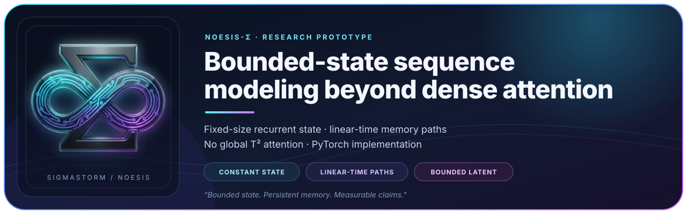
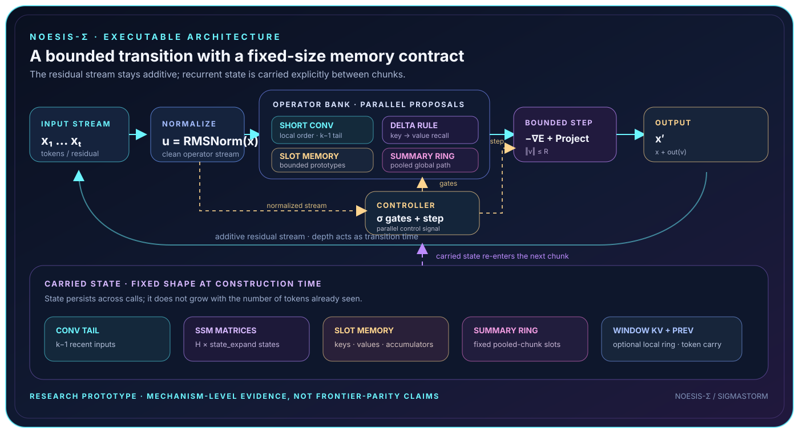
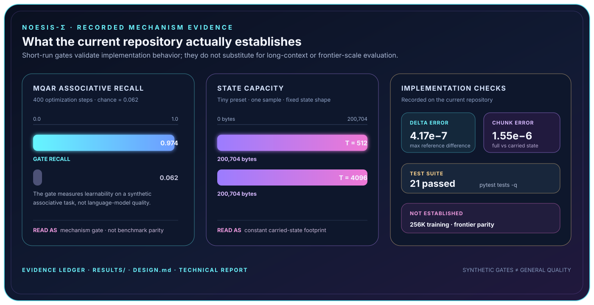

  

# NOESIS-Σ

> **Naming:** NOESIS-Σ is the research project. **SigmaStorm** is the executable model and Python
> package implemented in this repository.

## Research snapshot

NOESIS-Σ investigates sequence modeling with a **bounded token-local latent** and an explicit,
fixed-shape recurrent state. The prototype combines local order, associative recall, slot
prototypes, pooled chunk summaries, an energy contraction, and an additive residual stream—without
global dense token-to-token attention.

The project is a mechanism-level research prototype. Its current evidence supports implementation
correctness, trainability on synthetic recall, and constant carried-state size at the tested lengths.
It does **not** claim frontier language-model quality, a matched transformer win, or a trained 256K
context model.

## At a glance

| Property | Current, repository-grounded description |
| :--- | :--- |
| Model family | Recurrent sequence model with optional local causal window attention |
| Core state | Fixed-shape latent transition state, associative matrices, slot memory, summary rings, and local buffers |
| Global path | Fixed ring of pooled chunk summaries; no full global token-pair score graph |
| Context contract | State is carried between calls and does not grow with the tested sequence length |
| Main recall path | Chunkwise gated delta rule with a learned, multi-timescale decay initialization |
| Current evidence | Chunk equivalence, constant state bytes, MQAR recall, and controlled ablations |
| Research boundary | 256K context and frontier-quality parity remain unmeasured |

## Architecture in one picture

  

<em>Figure 1. SigmaStorm keeps the residual stream additive while carrying a fixed-shape state between chunks.</em>

## The transition law

Each block advances a bounded latent once and returns the update to the residual stream:

~~~text
u        = RMSNorm(x)
proposal = normalized_gated_mix(operators(u)) − ∇E(u) + u
v        = Project‖v‖≤R(u + dt(u) · proposal)
x        = x + out_proj(v)
~~~

The gates are independent sigmoids. Operator outputs are RMS-normalized before their gated mixture,
and the mixture is normalized by the gate sum. The projection bounds the latent `v`; it does not
clamp the residual stream `x`.

There is no **global** `[T, T]` attention path. A local sliding-window operator is enabled on a
minority of blocks by default, while the recurrent and summary paths carry information across
chunks. The fixed-state contract is verified at `T = 512` and `T = 4096`; 256K is a design target,
not an evaluated result.

## Operator map

All sequence-complexity descriptions below are for fixed model width and fixed state capacities.

| Operator | Role | Sequence scaling | State carried |
| :--- | :--- | :--- | :--- |
| Short convolution | Local order and fast proposal | Linear in `T` for fixed kernel `k` | `k − 1` recent inputs |
| Gated delta rule | Associative key → value recall | Linear in `T` for fixed heads and width | `H × state_expand` matrices of `d_head × d_head` |
| Slot memory | Long-horizon prototype writes and reads | Linear in `T` for fixed slot count | Keys, values, usage, and write accumulators |
| Chunk summaries | Pooled global path without full token-pair attention | Linear in `T` for fixed summary ring | Fixed ring of summary keys and values |
| Window attention | Optional precise local copying | Local receptive field `W`; see implementation caveat below | Fixed local key/value ring |
| Energy potential | Learned anisotropic contraction | Linear in `T` for fixed rank | None |
| Bounded projection | Enforces `‖v‖ ≤ R` | Linear in `T` | None |
| Gated FFN / optional MoE | Per-token nonlinear compute | Linear in `T` for fixed width | None |

### The four architectural upgrades

- **Multi-timescale decay.** Delta-rule heads initialize on a log-spaced rate spectrum
  (`1e−4 … 3e−2`, corresponding to `α ≈ 0.9999 … 0.970`) and remain token-dependent and learned.
- **State expansion.** `state_expand` adds independent associative matrices without shrinking each
  head, so capacity and state cost scale linearly with the expansion factor.
- **Chunk summaries.** A fixed ring of pooled summaries provides a learned global path with constant
  state capacity.
- **Per-token slot writes.** Novelty, evidence, causal in-block deduplication, load-aware routing,
  and soft pseudo-count consolidation are implemented in the slot operator. The stronger novelty
  dead-zone and abstaining read are enabled by the Gap D configuration and documented separately.

### Fixed-state contract

`SigmaState` holds one `BlockState` per block. Depending on configuration, it carries:

- convolution tail and the previous normalized token;
- delta-rule associative matrices;
- slot keys, values, usage, and partial write accumulators;
- summary-ring keys, values, positions, and partial-chunk accumulator;
- the optional local window key/value ring.

These tensors have shapes fixed at construction time. The gate measures `200704` bytes per sample
for the tiny preset at both `T = 512` and `T = 4096`. This is a memory-footprint result, not proof
that a learned model has mastered arbitrarily long-range language understanding.

## Recorded evidence

  

<em>Figure 2. The repository’s strongest evidence is mechanism-level and explicitly bounded.</em>

| Check | Recorded result | Interpretation |
| :--- | :--- | :--- |
| Chunked delta rule vs. sequential reference | Maximum output/state difference `4.17e−7` | Chunkwise implementation agrees with the reference on the recorded gate |
| Full forward vs. carried-state chunks | Maximum hidden-state difference `1.55e−6` | State carry is equivalent at the tested split |
| State size vs. context length | `200704` bytes at both `T = 512` and `T = 4096` | Fixed carried-state footprint for the tiny preset |
| MQAR associative recall | `0.974` accuracy vs. `0.062` chance after 400 steps | Synthetic recall path is trainable |
| TinyStories 20M run | Held-out PPL `3.498` at step `10,604` | A small language-model prototype trains and generates |
| Test suite | `21 passed` | Current unit and equivalence tests pass |

The full records are available here:

- [20M TinyStories run](results/20m_tinystories.md)
- [Gap D gated slot-memory proof](results/gapd_proof.md)
- [Controlled experiment ladder](results/ladder.md)
- [Design notes and mathematical details](DESIGN.md)
- [Roadmap and scale plan](docs/ROADMAP.md)
- [Technical report](docs/paper/README.md)

## What the evidence does—and does not—show

### Supported by the current repository

- The chunkwise delta rule matches its sequential reference on the recorded numerical gate.
- The full model can carry state across an arbitrary tested split without changing the hidden
  sequence beyond the recorded tolerance.
- The tiny configuration has a carried-state footprint independent of the two tested context
  lengths.
- The MQAR task is learnable in the short CPU gate.
- The Gap D synthetic presence task supports a gated slot read; see the dedicated proof for its
  seeds, ablations, and limitations.

### Deliberately not claimed

- No 256K-token training or evaluation has been performed.
- No matched-parameter transformer language-model baseline has been completed.
- The TinyStories PPL is not a frontier-quality comparison and is sensitive to the 8K tokenizer and
  restricted corpus.
- The trained 20M checkpoint predates the Gap D slot-read fix; the fixed configuration has small-
  scale no-regression evidence, not a new 20M language-model checkpoint.
- Constant state size does not prove useful retrieval over tens of thousands of tokens.

## Implementation caveat: local window attention

The recurrent and summary operators are designed around fixed state capacities. The current
`WindowAttention` implementation applies a local causal mask, but constructs a mask shaped like
`[batch, heads, length, total]` for each input chunk. With a very large `micro_chunk`, that mask can
scale with the chunk length rather than behaving like a fused strict `O(T · W)` kernel.

Therefore, the honest statement is: **the architecture has no global full-sequence attention, but the
current dense PyTorch window implementation is not yet a deployment-grade strict-memory
implementation for arbitrary chunk sizes**. Fused kernels or window-sized subchunks remain future
engineering work.

## Quickstart

Create an environment and install the core dependencies:

~~~bash
python -m venv .venv
source .venv/bin/activate
python -m pip install -r requirements.txt
~~~

Run the verification gates and tests. The gate automatically uses CUDA when it is available;
otherwise it runs on CPU:

~~~bash
python scripts/gate.py
python -m pytest tests -q
~~~

Train the recorded 20M configuration on uint32 token shards:

~~~bash
python scripts/train.py \
  --config configs/sigma_20m.json \
  --data_dir /path/to/shards \
  --seq_len 8192 \
  --micro_chunk 2048 \
  --bptt_chunks 4 \
  --batch_size 2 \
  --steps 5000 \
  --nproc 2
~~~

Training resumes from `runs/sigma/latest.pt` automatically. Add `--fresh` to ignore an existing
checkpoint.

Evaluate a checkpoint. The architecture configuration is loaded from the checkpoint itself:

~~~bash
python scripts/eval.py \
  --checkpoint runs/sigma/latest.pt \
  --data_dir /path/to/shards \
  --seq_len 8192
~~~

## Build a corpus

The corpus builder trains an 8K target-vocabulary byte-level BPE tokenizer and writes EOS-separated
uint32 shards. The TinyStories source uses the Hugging Face `datasets` package and network access:

~~~bash
python -m pip install datasets
python scripts/build_corpus.py \
  --source tinystories \
  --out_dir data/tinystories \
  --train_tokens 300_000_000 \
  --val_tokens 5_000_000
~~~

For a local text file or directory of `.txt` files, use `--source text --input <path>` and the core
dependencies are sufficient. The builder writes `tokenizer.json`, train/validation metadata, and
uint32 shard files; these generated data products are intentionally ignored by Git.

For Kaggle workflows, see [docs/KAGGLE.md](docs/KAGGLE.md). The local `kaggle/` workspace is
intentionally ignored and is not part of the published source tree.

## Reproduce the evidence

The short mechanism gate and unit suite are the first reproducibility checks:

~~~bash
python scripts/gate.py
python -m pytest tests -q
~~~

The Gap D proof can be reproduced locally with:

~~~bash
python scripts/gapd_proof.py --device cpu \
  --steps 800 --aggregate_steps 600 --mqar_steps 400 --seeds 0,1,2 --out_dir results
~~~

The result files are records of specific experiments, not guarantees for every seed, dataset,
hardware configuration, or future model revision.

## Three details that make recall learn

These implementation facts are documented in [DESIGN.md](DESIGN.md):

1. The delta rule uses the **previous token as the key** and the current token as the value.
2. It reads the **clean stream**, and its decay bias is initialized on a long-lived spectrum.
3. The transition is an **additive residual** with a normalized convex mixture and per-operator
   RMSNorm.

## Repository layout

~~~text
sigmastorm/         model, transition law, controller, state, and operators
training/           sharded data, MQAR tasks, trainer, and evaluation
scripts/            train, eval, gate, corpus, ladder, and proof utilities
configs/            tiny, MQAR, 20M, Gap D, and 100M presets
tests/              equivalence, state, boundedness, gradient, and recall tests
results/            recorded gates, ablations, and training reports
docs/               roadmap, Kaggle instructions, findings, and technical report
assets/             source mark, README banner, architecture map, and evidence figure
data/               local generated corpus/tokenizer output; ignored by Git
kaggle/             local-only workflow files; ignored by Git
~~~

## What this is not

- Not a transformer with layers removed: the central design is recurrent state plus a bounded
  transition, with local attention retained only as an optional precise-copy operator.
- Not a claim of frontier quality: the available hardware and data budget are research-scale.
- Not a claim that the energy term is a multi-basin memory: strong convexity makes it a stabilizer;
  the delta rule and slot memory carry information.
- Not a claim that the trained 20M slot memory is already a reliable content-addressed retriever;
  the strongest demonstrated associative recall is primarily the MQAR delta-rule path.

## License and citation

The original source code and project materials in this repository are released under the
[Apache License 2.0](LICENSE). Apache-2.0 permits research, commercial use, modification, and
redistribution subject to its notice, attribution, and license conditions; it also includes an
express patent license.

If you use NOESIS-Σ in research, software, or derivative work, please preserve the license notices
and cite the project using [CITATION.cff](CITATION.cff). A citation request is separate from the
license permission: the project is intended to be usable by others, while still receiving academic
credit.

Third-party dependencies, datasets, pretrained artifacts, and generated data may have separate
terms. This repository does not relicense those materials under Apache-2.0.
